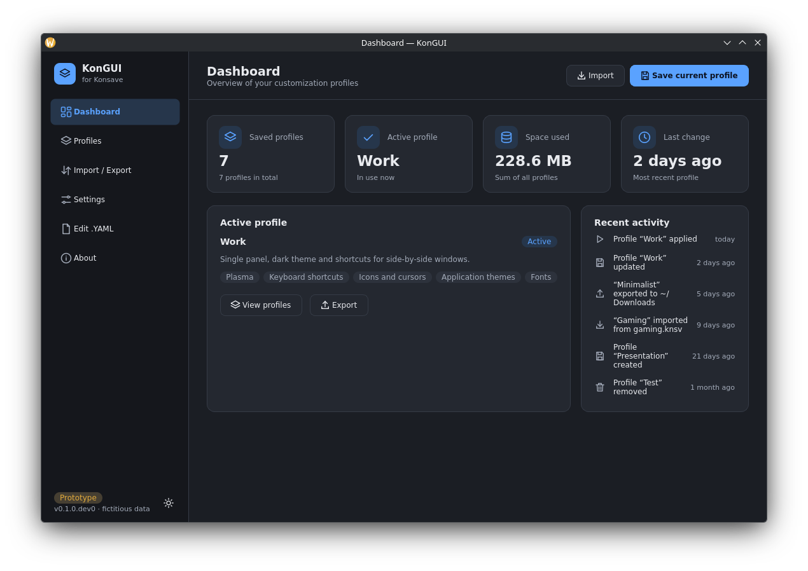

<p align="center"></p>

<h1 align="center">KonGUI</h1>

<p align="center">
A graphical interface for managing KDE Plasma configuration profiles, built as an independent fork of <a href="https://github.com/Prayag2/konsave">Konsave</a>.
</p>

> **Status: early development, published as GitHub [*pre-releases*](https://github.com/ericksousa32/kongui/releases)** (the first, `0.1.0a1`, on 2026-10-22): see [Installing the pre-release](#installing-the-pre-release). A first quick test on a real Plasma session (Fedora 44, Wayland) found no blocker; some checks are still to be done. Known limitations and decisions are listed in [`docs/LIMITATIONS.md`](docs/LIMITATIONS.md). It is an independent fork and is **not** affiliated with, endorsed by, or maintained by the Konsave authors.

## Overview

Konsave saves your desktop customizations (themes, icons, panels, shortcuts and other dotfiles) as named profiles that you can apply later or share as `.knsv` archives. It is a command-line tool.

KonGUI keeps Konsave's engine and data format and adds a desktop application on top of it, so the same operations can be done without memorizing flags. The project focuses on Linux and the KDE Plasma desktop, with Fedora KDE as the main target.

What it aims to solve:

- Make saving, applying, importing and exporting profiles approachable from a GUI.
- Make risky steps explicit: destructive actions ask for confirmation, and files are copied to a safety copy before a profile is applied or imported.
- Prevent two Konsave operations (two KonGUI windows, or KonGUI and the `konsave` command) from running over each other.

## Screenshots



The screenshots were taken in demo mode, so every profile shown is fictitious. View more in [screenshots](./screenshots/).

You can preview the interface without touching any real data using the demo mode described in [Running](#running).

## Features

### Working today

Everything below is covered by the automated test suite (run in temporary home directories with Qt in offscreen mode). A first quick test on a real Plasma session (Fedora 44, Plasma 6.7.5, Wayland) found every feature working; see [`docs/FINAL_AUDIT.md`](docs/FINAL_AUDIT.md) §7.

- **Profiles:** list, save, overwrite, apply, remove, and remove all. Destructive actions require confirmation.
- **Import / export:** `.knsv` archives. When the destination file already exists, the interface asks what to do instead of overwriting silently.
- **Import / export protections:** a `.knsv` above 512 MiB, with more than 10,000 entries or that really expands to more than 2 GiB is refused before anything is written; corrupted or unsafe archives get a clear message; free disk space is checked before import and export; a failed export keeps the previous one and leaves no temporary files. The limits are fixed constants (see [`docs/INTEGRATION.md`](docs/INTEGRATION.md) §10).
- **Profile description and sections:** an optional description per profile (saved with it or edited later from the card menu), and the sections of each profile read from its own `conf.yaml`. The description is kept next to the profile, not inside the `.knsv`, so it does not travel when exporting. What a profile contains is decided by `~/.config/konsave/conf.yaml`, which you edit by hand, as in Konsave.
- **Safety copies:** the files that would be replaced are copied before a profile is applied or imported. Copies can be listed, restored and deleted from *Settings*; nothing is deleted automatically.
- **Cross-process lock:** operations use a `flock` lock on `~/.config/konsave/.kongui.lock`. If another Konsave operation is running, KonGUI shows that it is waiting, stays responsive, and lets you cancel the wait. The bundled `konsave` command waits too (see [Command line](#command-line-bundled-konsave)). Programs that do not use the lock, such as Plasma itself or a text editor, are not covered.
- **Interface:** dashboard, profiles, import/export, settings and about pages; light, dark and system themes; keyboard shortcuts (`Ctrl+1` to `Ctrl+5` switch pages).
- **Language:** English and Brazilian Portuguese. The first time it runs, KonGUI follows the system language (`pt_BR` gives Portuguese; any other locale, including `pt_PT`, gives English). Change it any time in *Settings → Language*; the choice is saved, applies immediately without restarting, and is never overwritten by the system language afterwards. See [Language](#language).
- **Demo mode:** `--demo` runs the interface on fictitious in-memory data.
- **Safety:** KonGUI refuses to run as root, and profile or archive names are validated before anything reaches the original code.

### Choosing what a profile includes

As in Konsave, KonGUI has no screen for this: what a profile holds is set in `~/.config/konsave/conf.yaml`, which you edit by hand in any text editor (the file format is explained under [Command line](#command-line-bundled-konsave)). The default file Konsave creates already covers the usual Plasma settings, themes, icons, fonts and the layouts of the main KDE apps.

1. Edit `~/.config/konsave/conf.yaml`. The groups under `save:` are what every new profile contains; the groups under `export:` only travel in the `.knsv`. Keep a copy of the file before changing it: KonGUI does not check it or keep backups.
2. Save the profile in KonGUI. It gets a copy of `save` as it is *at that moment*; profiles saved earlier keep what they had. The cards show the sections each profile holds.
3. If the file has a mistake, saving fails and the notice shows Konsave's own reason; fix the file and save again.

Konsave writes the global `conf.yaml` into the `.knsv` when exporting, even if the profile was saved with another one; KonGUI does not change that (see [`docs/LIMITATIONS.md`](docs/LIMITATIONS.md) §2).

### In progress

- More testing on real Plasma sessions: X11, SELinux, Flatpak and quitting during an operation were not tested yet, and small layout and text alignment adjustments are planned. Reports are welcome: use the *Plasma test report* issue template ([`docs/PLASMA_TEST_PLAN.md`](docs/PLASMA_TEST_PLAN.md)).

### Planned

- Progress reporting and cancelling of long operations that have already started. The original engine cannot be interrupted today.

### Known limitations

The complete list, with the decisions behind it, is in [`docs/LIMITATIONS.md`](docs/LIMITATIONS.md). The main ones:

- Only partly validated in a real Plasma session: a quick test on Fedora 44 / Wayland passed; X11, SELinux and Flatpak were not tested.
- Import and export limits are fixed constants and estimates, not guarantees; the `.knsv` is not signed.
- `conf.yaml` is edited by hand, as in Konsave: KonGUI does not check it beforehand or keep backups of it; a mistake shows up when saving, with Konsave's reason.
- The `conf.yaml` stored in a `.knsv` is the global one (a Konsave behaviour); KonGUI does not warn when it differs from the profile's.
- Safety copies are never removed automatically and have no count limit.
- Starting `kongui` without PySide6 installed shows a plain `ImportError`; install the `gui` extra.

The detailed status of each requirement is in [`docs/FINAL_AUDIT.md`](docs/FINAL_AUDIT.md).

## Technologies

- Python 3.9 or newer (`python_requires` in `setup.py`); the test suite was run on 3.9 to 3.14
- [PySide6](https://doc.qt.io/qtforpython-6/) (Qt for Python) 6.8 or newer, for the interface (optional `gui` extra). On Python older than 3.12 the `gui` extra limits it to 6.8 and 6.9: PySide6 6.10 and newer crashed there (see [`docs/LIMITATIONS.md`](docs/LIMITATIONS.md) §5)
- [PyYAML](https://pyyaml.org/), as in Konsave (the only runtime requirement in `requirements.txt`; `setuptools` is needed to build the package, not to run it)
- Standard library only for the locking mechanism (`fcntl.flock`)
- Development: `unittest`, [black](https://github.com/psf/black), [pylint](https://pylint.org/)

## Installing the pre-release

> **Alpha software.** It rewrites real configuration files when you apply or import a
> profile. **Back up `~/.config` first**, try `kongui --demo` before anything else, and
> read [`docs/LIMITATIONS.md`](docs/LIMITATIONS.md). Help with the real-session checks
> is very welcome: [`docs/PLASMA_TEST_PLAN.md`](docs/PLASMA_TEST_PLAN.md).

The pre-releases are on the
[Releases](https://github.com/ericksousa32/kongui/releases) page (marked *Pre-release*;
the first one is [`0.1.0a1`](https://github.com/ericksousa32/kongui/releases/tag/v0.1.0a1)), each with the wheel, the sdist and a
`SHA256SUMS` file. There is no RPM, Flatpak or AppImage yet: the script `install.sh`
installs KonGUI for your user in a Python virtual environment and makes it open like
any other application.

### 1. Install (once)

```bash
curl -fsSLO https://raw.githubusercontent.com/ericksousa32/kongui/master/install.sh
bash install.sh
```

You can read the script before running it (`less install.sh`). It needs no root
(and refuses to run as root) and only writes inside your home folder:

1. it downloads the wheel of the **newest release** (pre-releases included) from
   GitHub and checks it against that release's `SHA256SUMS`;
2. it installs it, with PySide6, in its own virtual environment, `~/.venvs/kongui`
   (KonGUI ships its own copy of the `konsave` Python package and must not replace an
   existing Konsave);
3. it links the `kongui` command into `~/.local/bin` (never `konsave`);
4. it adds KonGUI to the application menu (`~/.local/share/applications/kongui.desktop`)
   with its icon, copied into your icon theme (`~/.local/share/icons/hicolor`).
   Releases up to `0.1.0a2` have no icon; for them the menu shows a generic one.

The first installation downloads PySide6 (Qt) and can take a few minutes. It needs
`python3` 3.9 or newer, `curl` and `sha256sum`, all part of Fedora.

Options: `bash install.sh --release 0.1.0a1` installs a given release;
`bash install.sh --wheel ./kongui-0.1.0a1-py3-none-any.whl` installs a wheel you
already downloaded (checked against a `SHA256SUMS` next to it, if there is one);
`bash install.sh --help` lists them. From `0.1.0a2` on, `install.sh` is also attached to
each release and listed in its `SHA256SUMS`.

The script never replaces a file it did not make: a `~/.local/bin/kongui` that is not a
link, a different `kongui.desktop`, or a `~/.venvs/kongui` folder that is not KonGUI's
environment are left alone (with a warning, or an error for the folder). On uninstall
it only deletes the icon files that are still the ones it installed.

### 2. Open it (every time)

No command has to be repeated:

* from the **application menu**: search for *KonGUI* (you can pin it to the panel or
  the task manager);
* or in **any terminal**: `kongui` (real profiles) or `kongui --demo` (fictitious
  data, nothing is read or written).

If a terminal says `kongui: command not found`, open a new terminal. On Fedora,
`~/.local/bin` is in the `PATH` of bash; with zsh add
`export PATH="$HOME/.local/bin:$PATH"` to `~/.zshrc`, with fish run
`fish_add_path ~/.local/bin`. The full path always works:
`~/.venvs/kongui/bin/kongui`.

### 3. Update

Run the script again (`bash install.sh`, or with `--release VERSION`). It updates
KonGUI in the same environment, and the command and the menu entry keep working. If
the environment stopped working (for example after a Fedora upgrade changed the
Python version), the script makes it again.

### 4. Uninstall

```bash
bash install.sh --uninstall
```

It removes the environment, the command, the menu entry and the icon. Your profiles, safety
copies and `conf.yaml` stay where Konsave keeps them (`~/.config/konsave`, including
`kongui-backups/`), and KonGUI's preferences in `~/.config/kongui/`; delete them by
hand only if you no longer want them.

<details>
<summary>Installing by hand, without the script</summary>

The same steps the script does, for a wheel and `SHA256SUMS` downloaded from the
release page into the current folder:

```bash
sha256sum -c --ignore-missing SHA256SUMS
python3 -m venv ~/.venvs/kongui
~/.venvs/kongui/bin/pip install "./kongui-0.1.0a1-py3-none-any.whl[gui]"
mkdir -p ~/.local/bin ~/.local/share/applications
ln -sf ~/.venvs/kongui/bin/kongui ~/.local/bin/kongui
printf '[Desktop Entry]\nType=Application\nName=KonGUI\nExec=%s\nIcon=kongui\nTerminal=false\nStartupWMClass=kongui\nCategories=Settings;DesktopSettings;Utility;\n' \
  "$HOME/.venvs/kongui/bin/kongui" > ~/.local/share/applications/kongui.desktop
# the icon (releases after 0.1.0a2), from the installed package into your icon theme
icons="$(~/.venvs/kongui/bin/python -c 'import kongui, os; print(os.path.join(os.path.dirname(kongui.__file__), "gui", "data", "icons", "hicolor"))')"
mkdir -p ~/.local/share/icons && cp -r "$icons" ~/.local/share/icons/
```

To update, install the new wheel with `pip install --upgrade` into the same
environment (and copy the icon again); to uninstall, delete `~/.venvs/kongui`,
`~/.local/bin/kongui`, `~/.local/share/applications/kongui.desktop` and
`~/.local/share/icons/hicolor/*/apps/kongui.*`.

</details>

### Reporting

To report a problem, open an issue and include the version shown in *About*. To tell
how it went on your Plasma session (even if all went well), use the *Plasma test
report* issue template.

## Installation (development)

There is no released package yet. To try KonGUI from a clone of this repository:

```bash
git clone https://github.com/ericksousa32/kongui.git
cd kongui
python3 -m venv .venv
. .venv/bin/activate
pip install -e ".[gui]"
```

Use a virtual environment: the package is called `kongui` and installs the `kongui` command plus the bundled `konsave` command, and both come with a Python package named `konsave`, so it would replace an existing Konsave installation. The version is taken from the git tag (`setuptools_scm`) and the interface shows that same version (`dev` when the code runs from a clone that was never installed); see [`docs/RELEASING.md`](docs/RELEASING.md). Install from a clone, from a release sdist, or from a `git archive` of a tag (GitHub's "Source code" files); a copy of the files made by hand, without `.git`, cannot be built.

Linux only. The install and launch commands above were checked with Python 3.13 in a fresh virtual environment (Qt offscreen), installing from a local clone of this repository.

## Running

Installed from a pre-release, KonGUI opens from the application menu or with `kongui`
in any terminal ([Open it](#2-open-it-every-time)). From a clone, activate the clone's
virtual environment first (`. .venv/bin/activate`), then:

```bash
kongui --demo            # fictitious data; nothing is read from or written to your profiles
kongui                   # real profiles in ~/.config/konsave
python3 -m kongui.gui    # same as `kongui`; --demo also works
```

Run it as a regular user: KonGUI exits with an error if started as root. Preferences are stored in the user's Qt application config folder (`kongui/kongui-gui.ini`).

Applying a profile rewrites your real configuration files and may require logging out and back in to take full effect. Try `--demo` first, and note that the safety copies mentioned above are made before each apply.

## Command line (bundled Konsave)

The repository includes the Konsave source (`konsave/`), and the `konsave` command works as before. KonGUI changes it only to take the cross-process lock; every change is listed in [`docs/KONSAVE_PATCHES.md`](docs/KONSAVE_PATCHES.md), written to make updating to a newer Konsave release easier.

<details>
<summary>Command reference</summary>

| Command | Description |
|---|---|
| `konsave -h` / `--help` | Show help |
| `konsave -s <name>` / `--save` | Save the current configuration as a profile (add `-f` to overwrite) |
| `konsave -l` / `--list` | List profiles |
| `konsave -a <name>` / `--apply` | Apply a profile (you may need to log out and in) |
| `konsave -r <name>` / `--remove` | Remove a profile |
| `konsave -w` / `--wipe` | Remove all profiles |
| `konsave -e <name>` / `--export-profile` | Export a profile as a `.knsv` file; add `-d <directory>` / `--export-directory` and `-n <name>` / `--export-name`, and `-f` to overwrite (without it, the name gets a date and time) |
| `konsave -i <file>` / `--import-profile` | Import a `.knsv` file |
| `konsave -v` / `--version` | Show the version |

**Lock behavior** (differs from upstream): if another Konsave operation is running, the command waits up to 30 seconds and prints a message. Set `KONSAVE_LOCK_TIMEOUT` (seconds; `0` = do not wait; negative or `inf` = wait without limit) to change that. If the wait times out the command exits with status `75` and changes nothing; if the lock file cannot be used it exits with `1`; Ctrl+C while waiting exits with `130`. Details in [`docs/CONCURRENCY.md`](docs/CONCURRENCY.md).

</details>

<details>
<summary>The configuration file (<code>~/.config/konsave/conf.yaml</code>)</summary>

The file defines what is saved and what is only exported with a profile. On first use Konsave creates it from a KDE default when `XDG_CURRENT_DESKTOP` is `KDE`, and from a generic one otherwise. Edit it by hand in a text editor; KonGUI reads it but never changes it.

```yaml
---
save:
    name:
        location: "path/to/parent/directory"
        entries:
        # Files to be backed up. They must exist in the given location.
            - file1
            - folder1
export:
    # Files that are not saved, only exported and imported with the profile
    # (for example complete icon packs and themes).
    anotherName:
        location: "another/path/to/parent/directory"
        entries:
            - file1
...
```

Placeholders usable in `location`:

- `$HOME`: the home directory
- `$CONFIG_DIR`: `$HOME/.config`
- `$SHARE_DIR`: `$HOME/.local/share`
- `$BIN_DIR`: `$HOME/.local/bin`
- `${ENDS_WITH="text"}` / `${BEGINS_WITH="text"}`: folders whose names differ between computers but end or begin with the same text

```yaml
save:
    firefox:
        location: "$HOME/.mozilla/firefox/${ENDS_WITH='.default-release'}"
        entries:
            - chrome
```

</details>

## Language

The interface is written in English and translated to Brazilian Portuguese with Qt translations (`kongui/gui/translations/*.ts`, compiled to `*.qm`). Which language is used:

1. The language chosen in *Settings → Language*, if you chose one (stored in KonGUI's own settings file, never in Konsave's).
2. Otherwise the system locale: exactly `pt_BR` selects Portuguese, anything else selects English. This detection is never saved, so a later change of the system language is followed until you choose a language yourself.
3. A text with no translation is shown in English.

Known limits: the fictitious data of `--demo` (profile names, descriptions and activity) is always in English, while the interface around it is translated; notices already on screen and entries already in the activity list keep the language they were written in; and messages that come from the bundled Konsave code are translated by matching their English text, so a message that Konsave later rewords may appear in English. Details are in [`docs/GUI_PROTOTYPE.md`](docs/GUI_PROTOTYPE.md#8-language-i18n).

## Roadmap

No dates are promised. In rough order of priority:

1. More real Plasma session testing (X11, SELinux, Flatpak, quitting during an operation), the small layout adjustments the first test asked for, and fixes for what users report.
2. AppImage packaging, only after a working, tested build exists.
3. Progress and cancellation for operations already running, if the engine allows it.

Done so far: safety copies, cross-process lock, import and export limits, profile descriptions and sections, and the first alpha pre-release, `0.1.0a1` (2026-10-22).

## Compatibility

KonGUI uses the same profile folder and `.knsv` format as the Konsave code bundled in this repository, and the tests check that archives are exchanged correctly with the bundled `konsave` command in both directions. Compatibility with other Konsave releases has **not** been verified.

## Documentation

Technical documentation is in [`docs/`](docs/):
[integration layer](docs/INTEGRATION.md), [services used by the interface](docs/GUI_SERVICES.md), [interface prototype](docs/GUI_PROTOTYPE.md), [concurrency](docs/CONCURRENCY.md), [changes to Konsave](docs/KONSAVE_PATCHES.md), [limitations and decisions](docs/LIMITATIONS.md), [versions and releases](docs/RELEASING.md), the [test plan for a real Plasma session](docs/PLASMA_TEST_PLAN.md), the [test overview](docs/TEST_OVERVIEW.md) and the [final audit](docs/FINAL_AUDIT.md).

## Original project and credits

KonGUI is a fork of [Konsave](https://github.com/Prayag2/konsave), created by Prayag Jain and released under the GPL v3. The profile engine, the `.knsv` format and the configuration file design come from that project; thank you to its author and contributors. Konsave's history is kept in [`CHANGELOG.md`](CHANGELOG.md). Please report problems specific to KonGUI in this repository, not to the Konsave maintainers.

## Contributing

Bug reports and ideas are welcome: please open an issue in this repository, and discuss larger changes before starting. Read [`CONTRIBUTION.md`](CONTRIBUTION.md) first (inherited from Konsave; some of its details may not apply to this fork yet).

To work on the code:

```bash
pip install -e ".[gui,dev]"                   # PySide6 is needed: the GUI tests error without it
python3 -m unittest discover -s tests -t .    # or: make tests
make smoke                                     # quick check that the code starts
black kongui tests
pylint kongui
make translations                              # after changing interface texts (see docs/GUI_PROTOTYPE.md)
```

Run the tests as a regular user: they create temporary home directories and refuse to touch real files, and the file-writing ones are skipped when run as root. The tests never apply profiles to your real session.

## License

KonGUI is distributed under the **GNU General Public License v3.0**, the same license as Konsave. The full text is in [`LICENSE`](LICENSE). The original Konsave code remains the work of its authors and is included under the same license; keep this notice and the original credits when redistributing.
