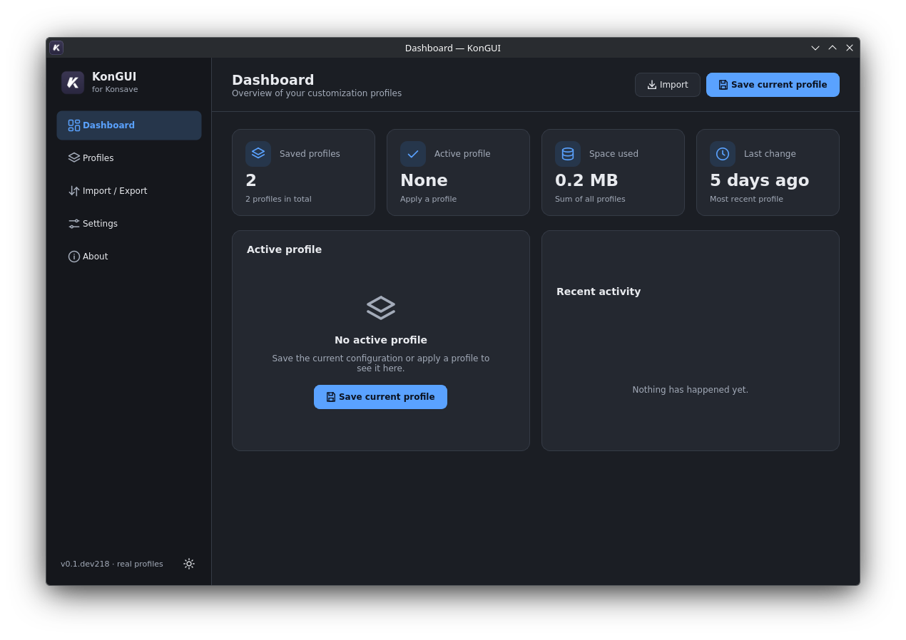

# KonGUI

A desktop application for saving, applying and sharing KDE Plasma configuration
profiles. It is an independent fork of [Konsave](https://github.com/Prayag2/konsave):
same engine, same profile folder, same `.knsv` files, plus a graphical interface.



*Screenshots are taken in demo mode, so every profile shown is fictitious. More in
[`docs/screenshots/`](docs/screenshots/).*

> **Status: alpha.** Published as GitHub
> [pre-releases](https://github.com/ericksousa32/kongui/releases) since `0.1.0a1`
> (2026-10-22), and from `0.1.0a4` (2026-11-07) also as signed AppImages for x86_64 and
> aarch64. A first test on a real Plasma session (Fedora 44, Wayland) found no
> blocker; X11, SELinux and Flatpak are not tested yet. KonGUI is **not** affiliated
> with, endorsed by, or maintained by the Konsave authors.

## What it does

- **Profiles:** save the current desktop as a named profile, apply, overwrite, remove
  or remove all. Destructive actions ask for confirmation.
- **Choose what goes in:** when saving, pick any of 12 categories (system settings,
  panels, themes, icons, wallpaper, fonts, app settings, window management, GTK,
  shortcuts, startup apps, other). Each profile card shows its categories.
- **Descriptions:** an optional note per profile, kept next to the profile (it does
  not travel inside the `.knsv`).
- **Import and export** of `.knsv` archives, with size and free-space checks, clear
  messages for broken or unsafe archives, and a question before overwriting a file.
- **Safety copies:** the files a profile would replace are copied before applying or
  importing. List, restore or delete them in *Settings*; nothing is deleted
  automatically.
- **No clashes:** a cross-process lock keeps two operations (two windows, or KonGUI
  and the `konsave` command) from running over each other. KonGUI shows that it is
  waiting and lets you cancel.
- **Interface:** light, dark and system themes; English and Brazilian Portuguese;
  shortcuts `Ctrl+1` to `Ctrl+5` for the pages; `--demo` mode with fictitious data.
- **Safe by default:** refuses to run as root and validates names before anything
  reaches the engine.

What it does not do yet, and why, is in [`docs/LIMITATIONS.md`](docs/LIMITATIONS.md).

## Installing the pre-release

> **Alpha software.** Applying or importing a profile rewrites real configuration
> files. **Back up `~/.config` first** and try `kongui --demo` before anything else.

Two ways, both for your user only and without root: the `install.sh` script (below),
which installs KonGUI in its own Python virtual environment and adds it to the
application menu, or, from `0.1.0a4` on, a single [AppImage](#appimage) file. There is
no RPM or Flatpak.

### Install

```bash
curl -fsSLO https://raw.githubusercontent.com/ericksousa32/kongui/master/install.sh
bash install.sh
```

The script needs no root (and refuses to run as root) and only writes inside your
home folder. It:

1. downloads the wheel of the newest release (pre-releases included) and checks it
   against that release's `SHA256SUMS`;
2. installs it with PySide6 in `~/.venvs/kongui` (so it never replaces an existing
   Konsave);
3. links the `kongui` command into `~/.local/bin` (never `konsave`);
4. adds a menu entry (`~/.local/share/applications/kongui.desktop`) and the icon
   (`~/.local/share/icons/hicolor`).

It needs `python3` 3.9 or newer, `curl` and `sha256sum` (all part of Fedora). The
first run downloads PySide6 and can take a few minutes; if it stops halfway, run it
again. It never replaces a file it did not create.

Options: `--release VERSION` installs a given release, `--wheel FILE` installs a wheel
you already downloaded, `--help` lists everything.

### Open

From the application menu (search for *KonGUI*), or in a terminal:

```bash
kongui          # your real profiles in ~/.config/konsave
kongui --demo   # fictitious data; nothing is read or written
```

If the terminal says `kongui: command not found`, open a new terminal. With zsh add
`export PATH="$HOME/.local/bin:$PATH"` to `~/.zshrc`; with fish run
`fish_add_path ~/.local/bin`. The full path always works:
`~/.venvs/kongui/bin/kongui`.

Applying a profile may need a log out and back in to take full effect.

### Update

Run `bash install.sh` again (optionally with `--release VERSION`). It updates the
same environment, and rebuilds it if it stopped working (for example after a Fedora
upgrade changed the Python version).

### Uninstall

```bash
bash install.sh --uninstall
```

This removes the environment, the command, the menu entry and the icon. Your data
stays: profiles, safety copies and `conf.yaml` in `~/.config/konsave` (including
`kongui-backups/`), and preferences in `~/.config/kongui/`. Delete them by hand if
you no longer want them.

### AppImage

Each release (from `0.1.0a4` on) also has `KonGUI-<version>-x86_64.AppImage` and
`KonGUI-<version>-aarch64.AppImage`: everything in one file (about 50 MB), nothing to
install.

```bash
chmod +x KonGUI-*-x86_64.AppImage
./KonGUI-*-x86_64.AppImage            # the interface (add --demo for fictitious data)
./KonGUI-*-x86_64.AppImage konsave -l # the bundled konsave command
```

It needs glibc 2.34 or newer on x86_64 and 2.39 or newer on aarch64 (any current
Fedora), and nothing else on Wayland; on X11 also `libxcb-cursor` (Fedora:
`xcb-util-cursor`, installed with Plasma). It does **not** need `libfuse2`. To add it
to the menu and get updates, open it with [Gear Lever](https://flathub.org/apps/it.mijorus.gearlever):
the file knows where its newer versions are published.

**Checking the download.** Next to the files, each release has `SHA256SUMS`, its GPG
signature `SHA256SUMS.asc` and the public key `kongui-signing-key.asc`; the AppImages
also carry their own signature. Check that the key's fingerprint is the one in
[`docs/RELEASING.md`](docs/RELEASING.md#signing-key), then:

```bash
gpg --import kongui-signing-key.asc
gpg --verify SHA256SUMS.asc SHA256SUMS
sha256sum --check --ignore-missing SHA256SUMS
```

Your profiles and preferences are the same files whichever way KonGUI was installed.

### Reporting problems

Open an issue and include the version shown in *About*. To tell how KonGUI behaved
on your Plasma session (even if everything worked), use the *Plasma test report*
issue template; the checklist is in
[`docs/PLASMA_TEST_PLAN.md`](docs/PLASMA_TEST_PLAN.md).

## Development

Linux only. Python 3.9 or newer; PySide6 6.8 or newer (on Python older than 3.12,
the `gui` extra limits it to 6.8–6.9, see [`docs/LIMITATIONS.md`](docs/LIMITATIONS.md)
§5). The only runtime requirement besides PySide6 is PyYAML.

```bash
git clone https://github.com/ericksousa32/kongui.git
cd kongui
python3 -m venv .venv
. .venv/bin/activate
pip install -e ".[gui,dev]"

kongui --demo                                 # or: python3 -m kongui.gui --demo
QT_QPA_PLATFORM=offscreen python3 -m unittest discover -s tests -t .   # or: make tests
make smoke                                    # quick check that the app starts
make appimage                                 # build an AppImage (docs/RELEASING.md §7)
```

Use a virtual environment: the package also installs a Python package named
`konsave`, which would replace an existing Konsave installation.

**Run the tests as a regular user.** They work in temporary home folders and never
touch your real files or session; as root, the tests that write files are skipped.

The version comes from the git tag (`setuptools_scm`); a clone that was never
installed shows `dev`. Build from a clone, a release sdist or a `git archive` of a
tag; a hand-made copy without `.git` cannot be built. See
[`docs/RELEASING.md`](docs/RELEASING.md).

Preferences are stored in `~/.config/kongui/kongui-gui.ini`.

How to contribute (branches, rules, formatting, translations):
[`CONTRIBUTING.md`](CONTRIBUTING.md).

## Command line (bundled Konsave)

The `konsave` command from the bundled `konsave/` package works as in Konsave 2.2.0.
KonGUI changes that code only where it must (the lock, the version name, and saving
from a filtered copy of `conf.yaml`); every change is listed in
[`docs/KONSAVE_PATCHES.md`](docs/KONSAVE_PATCHES.md).

| Command | What it does |
|---|---|
| `konsave -l` | List profiles |
| `konsave -s NAME` | Save the current configuration (`-f` to overwrite) |
| `konsave -a NAME` | Apply a profile |
| `konsave -r NAME` | Remove a profile |
| `konsave -w` | Remove all profiles |
| `konsave -e NAME` | Export as `.knsv` (`-d DIR`, `-n FILENAME`, `-f` to overwrite) |
| `konsave -i FILE` | Import a `.knsv` |
| `konsave -v` / `-h` | Version / help |

Unlike upstream, the command waits up to 30 seconds when another operation holds the
lock. `KONSAVE_LOCK_TIMEOUT` changes that (seconds; `0` = do not wait; negative or
`inf` = no limit). On timeout it exits with status `75` and changes nothing; Ctrl+C
while waiting exits with `130`. Details: [`docs/CONCURRENCY.md`](docs/CONCURRENCY.md).

What gets saved is defined in `~/.config/konsave/conf.yaml`, created on first use
(a KDE default when `XDG_CURRENT_DESKTOP` is `KDE`). Groups under `save:` go into
every profile; groups under `export:` only travel in the `.knsv`:

```yaml
save:
    name:
        location: "$CONFIG_DIR"
        entries:
            - kdeglobals
export:
    icons:
        location: "$SHARE_DIR"
        entries:
            - icons
```

`location` accepts `$HOME`, `$CONFIG_DIR` (`~/.config`), `$SHARE_DIR`
(`~/.local/share`), `$BIN_DIR` (`~/.local/bin`) and `${ENDS_WITH="text"}` /
`${BEGINS_WITH="text"}` for folders whose names change between computers. KonGUI
reads this file but never changes it; the category choice when saving works on a
temporary filtered copy. More: [`docs/LIMITATIONS.md`](docs/LIMITATIONS.md) §4.

## Language

English and Brazilian Portuguese (Qt translations in `kongui/gui/translations/`).
KonGUI uses the language picked in *Settings → Language*; until you pick one, it
follows the system locale (exactly `pt_BR` gives Portuguese, anything else English).
The change applies immediately. The fictitious `--demo` data is always in English.
Details: [`docs/GUI.md`](docs/GUI.md).

## Documentation

| Document | Contents |
|---|---|
| [`docs/GUI.md`](docs/GUI.md) | The interface: pages, shortcuts, services, language |
| [`docs/INTEGRATION.md`](docs/INTEGRATION.md) | The `kongui/core` layer that talks to the Konsave engine |
| [`docs/KONSAVE_PATCHES.md`](docs/KONSAVE_PATCHES.md) | Every change made inside `konsave/` |
| [`docs/CONCURRENCY.md`](docs/CONCURRENCY.md) | The cross-process lock |
| [`docs/LIMITATIONS.md`](docs/LIMITATIONS.md) | What KonGUI does not do, decisions and open items |
| [`docs/RELEASING.md`](docs/RELEASING.md) | Versions and the release process |
| [`docs/PLASMA_TEST_PLAN.md`](docs/PLASMA_TEST_PLAN.md) | Checklist for testing on a real Plasma session |
| [`docs/TEST_OVERVIEW.md`](docs/TEST_OVERVIEW.md) | What the automated tests cover |
| [`CHANGELOG.md`](CHANGELOG.md) | Changes per release |

## Compatibility

KonGUI uses the same profile folder and `.knsv` format as the Konsave code bundled
here, and the tests exchange archives with the bundled `konsave` command in both
directions. Other Konsave releases have not been verified.

## Credits

KonGUI is a fork of [Konsave](https://github.com/Prayag2/konsave), created by Prayag
Jain. The profile engine, the `.knsv` format and the configuration file design come
from that project; thank you to its author and contributors. Please report problems
specific to KonGUI here, not to the Konsave maintainers.

## License

[GNU General Public License v3.0](LICENSE), the same license as Konsave. The original
Konsave code remains the work of its authors; keep this notice and the original
credits when redistributing.
